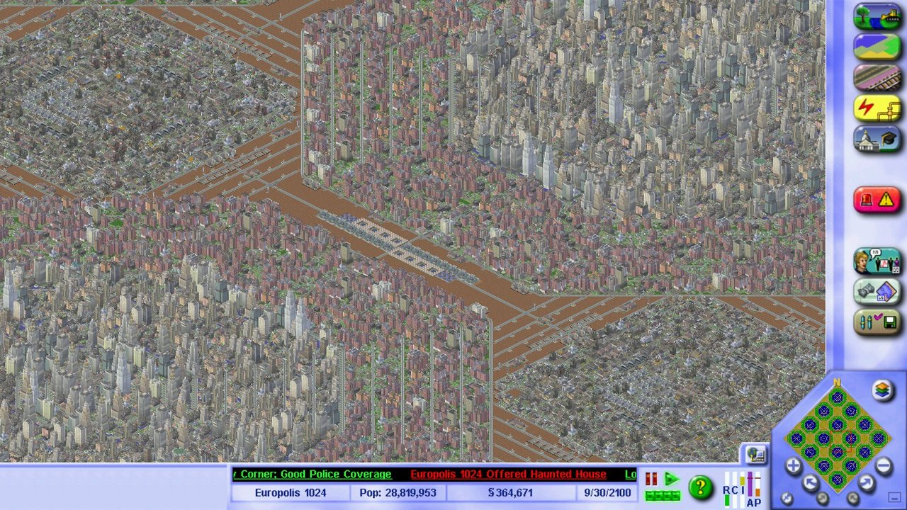
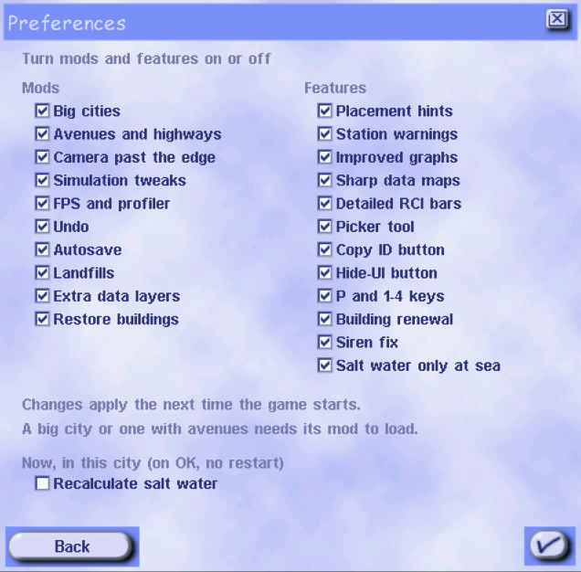

# sc3kre — SimCity 3000 Unlimited reverse-engineering

Static reverse-engineering of **SimCity 3000 Unlimited** (Maxis / Electronic Arts, 2000),
a 32-bit x86 Windows game. The goal is a **modding and format toolkit**: documented,
round-tripping file formats, and mods for the retail game built on that knowledge (below).
A source port is not planned.

This repository contains **only original work**: our own tools and our own analysis notes.
It contains **no game assets, no binaries, and no decompiled EA/Maxis code**. See
[What is NOT in this repo](#what-is-not-in-this-repo-and-why). You need your own legally
obtained copy of the game to use any of it.

## The mods (sc3mods)

Ready-to-use mods for your own copy of SimCity 3000 Unlimited, published as zips on the
[Releases](https://github.com/nanofives/sc3kre/releases) page (the newest one is at the top).

**Install.** Unzip into the game folder (the one with `Apps` and `Cities`, `SC3U.exe` is inside `Apps`), run
`powershell -ExecutionPolicy Bypass -File .\sc3mods_patch.ps1` once in that folder, start `Apps\SC3U.exe`. GOG and
Steam copies both work.
`sc3mods_patch.ps1 -Restore` goes back to stock. Each release has a `README.txt` with install steps, every option
and what changed.
Bitdefender flagged `sc3netmod.dll` up to 2026-11-10 (Gen:Variant.Draftor.8144, a false positive). From 2026-11-10b
every mod DLL carries version information and scans clean.

**Settings.** Preferences > "Mod options..." holds the settings (interface scale, FPS limit, autosave, camera
speeds, language). "Turn mods on/off..." on that page switches each mod, and the main features inside them, on or
off from the next start (saved in `Apps\sc3mods.ini`). The mods' own text comes in 7 languages (English, Spanish,
French, German, Italian, Dutch, Swedish) and follows the game's language.


*A 1024 tile city in a 1600x900 window.*


*Preferences > Mod options > Turn mods on/off.*

### Window and interface (sc3resize)
- Resizable window, maximize, and borderless fullscreen with Alt+Enter. Size and state are remembered and the game
  always opens on the main screen.
- Interface scale ("Auto" by default, or Normal, 125%, 150%, 200%): bottom bar, side panel, minimap and dialogs grow
  with the window. Text is redrawn sharp at the larger size instead of stretched, and so are the minimap and the
  data maps.
- Extra zoom steps x2 and x3 past the closest stock zoom on large windows.
- The main menu scales to the window, with an upscaled menu picture (`menu_bg.bmp`, replaceable).
- P pauses, 1 to 4 set the speed.
- Right-drag scrolling with bigger arrows, and two camera speed sliders (arrow keys, right-button drag).
- A button under the minimap hides the whole interface for a clean view of the city.
- Language button on the mod options page: picks which of the installed text languages the game uses.
- Many crash and drawing fixes for large windows (repaint gaps, odd window heights, dialogs cut off, files the game
  locked against other readers).

### Building tools (sc3resize)
- "Move" button in the query window of rewards, business deals and landmarks: pick the building up and place it
  somewhere else (half its price plus bulldozing and levelling).
- Buildings placed from a menu, and road, rail, highway and power line drags, can go over zoned buildings,
  which are demolished first (bulldozing added to the cost, undo puts them back).
- Zoning over buildings of another zone type, and de-zoning, demolish them (same type left alone).
- Picker: the eyedropper button under the minimap, or Ctrl+F, then click a building, zone or road to select its
  build tool with the same item.
- Placement hints: hold Shift while placing a building to see the cells where it raises land value, with the change
  for R, C and I next to the cost. For a station or bus stop, Shift shows its walking reach and how many trips
  start there and use transit.
- Station warnings: stations the trip router cannot use (no track, no exit to a road, nothing at the other end)
  blink red, the query window says why, and the transport charts count them.
- "Copy ID" button in the query window: copies the building or network piece ID, for modders.

### Information (sc3resize + sc3dataview)
- Graphs page with tabs (City, Economy, Services, Utilities, Environment), a scale on the left, and five more
  graphs: income and expenses, power supply and demand, water supply and delivery, R/C/I demand, air and water
  pollution, with their 10 and 100 year history.
- More data maps (press V on the data map window): radiation, whether each lot's trips arrive, congestion on
  streets, highways and subway separately, and a public transit map that marks lots whose trips use no bus, rail or
  subway.
- Charts for school and hospital places against demand, water, and transport.
- Two more bars on the RCI meter: A (airport) and P (seaport), the commercial and industrial demand ceiling each one
  sets.

### Bigger cities (sc3bigcity)
- A "Huge" size in the new city dialog, with a slider from 512 to 1024 tiles in steps of 128. 1024 cities load,
  reload and run (with sc3perf).

### Camera (sc3overscroll)
- The camera can go past the map edge and slides along it. Pushing the mouse past the window edge while building
  scrolls the camera, faster the harder you push.

### Simulation (sc3simrun)
- The date and the simulation keep going while you move the camera.
- Working buildings are no longer torn down at random and rebuilt as the same kind of building (the game's
  "anarchy" roll). Upgrades to pricier or denser buildings still happen. `simrun.ini [churn]` sets each roll.
- Sirens no longer play on every emergency vehicle in view one after the other: only vehicles that rolled a siren
  sound one, the roll is 20% of the game's chance, and the same siren waits 30 s before it plays again
  (`simrun.ini [sirens]`: `per_vehicle`, `chance_pct`, `cooldown_s`).
- Salt water only at sea: all sea water reached from the map edge is salt, rivers and lakes stay fresh (the stock
  game drew straight lines in from the edges). New maps get it by themselves, an existing city when you tick
  "Recalculate salt water". It decides where pumps and desalination plants work.

### Speed and stability (sc3perf)
- Faster drawing, frame cap, FPS counter and profiler (one font and size on every screen), traffic simulation on several threads, and the fixes that make
  1024 cities load, reload and run without freezing or crashing.
- Crash guards from thronevintagetech's SC3KU Enhancement Package: an object already at a zero count is never freed
  twice, and the demand valve layer's shutdown is protected.

### Roads, avenues and highways (sc3netmod + road data)
- Avenues with 2 lanes each way (right-hand traffic, lane markings), on slopes too, also where they pass under a
  highway next to its ramps. Avenues that stay two-way keep the stock look and lanes.
- Boulevards: three parallel roads become a boulevard with a median.
- Diagonal avenues and boulevards, with junctions, crosswalks, merges and bends.
- Avenue junctions with roads and with other avenues, corners, T junctions, dead ends and U-turn ends, and a
  boulevard that narrows into an avenue with a side avenue joining.
- Roundabouts: a 2x2 road square becomes a roundabout by itself, plus a 3x3 one.
- Highway interchanges (diagonal ones too) that finish building, on-ramps, capped joins, correctly lit walls, roads kept
  under highway T junctions.
- Highway S curves where two parallel highways one cell apart overlap.
- Traffic that uses avenues, boulevards and highways more, and road density that follows the turns cars make.
- Rounded road ends on slopes.
- Cars on the far side of an avenue draw behind the median trees (stock avenues inside a band too).

### Undo (sc3undo)
- Ctrl+Z / Ctrl+Y (or buttons under the minimap) undo and redo zoning, networks, buildings, the bulldozer and
  terrain tools, money included.

### Landfills (sc3landfill)
- Each zone sends its garbage to the nearest landfill with room, and every landfill keeps its own pile. The query
  window shows how full one is, with an "Empty" button that empties it for a fee.

### Restore buildings (sc3restore)
- Buildings that age (power plants, water treatment, incinerators, recycling) get a "Restore" button in their query
  window: pay part of the build price (by default half the price times the share of its life used) and the building
  is new again, output included. An hourglass button lists every ageing building in the city.

### Autosave (sc3autosave)
- Saves the city every 5 minutes (10, 15, 30 or 60 selectable) with the game's own Save, into three files beside
  it, `(auto 5 min)`, `(auto 10 min)` and `(auto 1 h)`, never into your own file. It waits for a pause in your input,
  shows a small corner notice instead of the large saving box, and a loaded autosave saves back to the city's own
  file.

### Terrain editor and weather (sc3resize)
- The New City terrain panel is taller, with "Bosque denso" (forest on all land at the tree bar's density, also after
  Re-Generate, planted a strip at a time so big maps do not freeze) and a
  "Natural World" switch for the Classic Natural World terrain and water colours by thronevintagetech.
- "Weather: Rain and clouds" on the mod options page keeps the game's own clouds and rain on.

### Community mods (optional, `community\` in the release)
Apache Flyover and Civic Deals + Extra Cheats by thronevintagetech and Null 45, shipped with the authors'
permission. `community\community_patch.ps1` installs them on your own game files and `-Restore` removes them.
Run it again after installing a new sc3mods release: it also writes the petitions into the road mod's own `SYS.PAK`
in `mods\netmod`, which a new release replaces.
- Civic Deals: two new Reunirse offers (in Spanish on a Spanish game), forest and weather cheats. A "forest" button
  joins the Landscape tool menu. Extra Cheats: dotcom, moolah, SimDate (SimDate fixed by sc3resize).
- Apache Flyover, built from the author's source in [`re/community/apache`](re/community/apache): works on 1024 maps,
  the patrol follows roads between the military base and the police stations, a Reunirse offer when crime is high
  and the city has a military base, and the game's own helicopter sound.

### Your Building Architect buildings in zones (`tools\bat_growables.ps1`)
Every building in your game's Building Architect list becomes a zoned building of its own that grows next to the
game's buildings. Nothing is replaced. It needs the road mod (`mods\netmod`), which every sc3mods release has.
1. Close the game. Run `powershell -ExecutionPolicy Bypass -File .\tools\bat_growables.ps1` in the game folder.
2. It writes `bat_growables.ini` in the game folder, one section per building. Each has `enabled`, `class` (the kind
   of zone lot it grows on, the classes and the lot sizes they take are listed at the top of the file) and `weight`
   (how often it's picked, a game building has 1 to 10). Houses, shops and factories start enabled, with a class guessed
   from the building's `.bld` file in `Buildings`. Anything else (a school, a park) starts at `enabled = 0`.
3. Change what you like and run the script again. Start the game as usual.
- To add a building of your own: in a city, open the Replace window of a building of the same size, use "Edit list"
  to add your .bld, close the game and run the script again. It picks up the new building and keeps the numbers of
  the ones you already have.
- Your building takes its population, jobs and other stats from a game building of the same class and size.
- Run the script again after installing a new sc3mods release, since the release replaces the files in `mods\netmod`.
- `-Restore` takes the buildings out again and puts every file back. Your `bat_growables.ini` stays.
- A city saved with these buildings and loaded without them doesn't crash. Each one becomes a game building of the
  same type.

Every fix has an off switch (an environment variable or an ini key), listed in the release `README.txt`. The mods
contain no game code or data. The road data in `mods\netmod` is built from your own game files.

## How the reverse engineering was done

The mods come out of a static reverse-engineering pass over the retail game. In short:

- **Ghidra, offline.** Every binary is imported into Ghidra headless and the whole decompilation is exported as
  text, so it can be searched like source code. That export stays private (it is EA's code), the scripts that make
  it are in `re/scripts/`.
- **The game lives in its DLLs.** `SC3U.exe` is a thin GZCOM shell. The simulation, the UI and the renderer are in
  29 director DLLs under `Apps\`, each registering its classes the same way. Mapping that recipe first made the
  rest of the code navigable.
- **Named hints from other builds.** The PC binaries carry no function names. The iOS *SimCity Deluxe* build of the
  same engine ships with its C++ names, and the Loki Linux demo has symbol names. Both are used as hints only:
  a name counts once the PC code confirms it (constants, strings, call structure).
- **Formats first.** QFS/RefPack compression, the sprite format and the `.IXF`/`.DAT` containers are fully decoded,
  with Python tools in `re/tools/` that round-trip the game's own files (details below).
- **Runtime checks.** Frida hooks and WinDbg time-travel recordings show which code writes a value while the game
  runs, to confirm what the static reading says.
- **Mods as small DLLs.** Each mod is a C DLL that hooks the game at the addresses found above. A small loader
  (`sc3mods.dll`) loads them, and the patch script adds that loader to the game exe and can take it out again.
- **No guessing.** Notes report only what the decompilation shows, with the address for every constant and
  offset, and mark the rest as uncertain. Per-function status is tracked in `functions.csv`.

## Headline findings

- **The simulation is not in `SC3U.exe`.** That executable is a GZCOM shell. The actual game
  logic lives in **29 GZCOM director DLLs** shipped in the game's `Apps\` folder (6.2 MB of
  code). Every module follows one registration recipe (a director registers N classes by
  GZCLSID, each behind a `operator new` + constructor factory). See
  [`re/analysis/MODULE_MAP.md`](re/analysis/MODULE_MAP.md) and
  [`MODULE_INVENTORY.md`](re/analysis/MODULE_INVENTORY.md).

- **QFS / RefPack decompressor fully recovered** ([`re/tools/qfs.py`](re/tools/qfs.py)),
  transcribed from the shipped decompressor. **63,691 of 63,691** sprite streams decompress
  to their declared uncompressed size (a C4 round-trip result).

- **Sprite format fully decoded** ([`re/tools/sprite_render.py`](re/tools/sprite_render.py)):
  per-row span encoding with RGB565 / RGB555, plus an 8bpp 5-bit coverage-mask class, plus
  4-by-int16 anchor records. **62,552 of 62,552** records pass 7 independent structural
  predictions.

- **An independent second witness.** The `.SII` text mirrors that ship beside the sprite
  archives corroborate the decoded records: **8,132 joins, 0 mismatches**.

- **`.IXF` container cracked.** Magic `0x80C381D7`, a 20-byte index record
  `{group, instance, type, offset, size}`. One reader and two writers in the binaries all
  agree on the layout. Parser: [`re/tools/ixf_parse.py`](re/tools/ixf_parse.py).

- **Sim models read out of the decompilation.** Power is a masked bitmap dilation flood-fill
  (32 tiles per dword, capacity constant `600` at a cited address). Traffic is a trip and
  cell-cost commute model. Budget, ordinances, aura, and neighbor deals are mapped to their
  record structures. See the per-subsystem docs under `re/analysis/`.

## Tracker status

The single source of truth for per-function status is [`functions.csv`](functions.csv), one
row per address. Current standing:

| Confidence | Count |
|---|---|
| C0 unreviewed | 4,843 |
| C1 triaged | 108 |
| C2 decompilation read + named | 543 |
| C3 behavior confirmed | 10 |
| C4 fully verified | 5 |
| **Named** | **635** |

## Confidence ladder

Every claim in this project is tagged with a confidence level. Nothing above C0 is asserted
without cited evidence from the decompilation.

- **C0** unreviewed. Auto-analysis output only, an unnamed function.
- **C1** triaged. Subsystem-classified with a one-line purpose from strings or cross-references.
- **C2** decompilation read. Mechanically described, callees identified, named.
- **C3** behavior confirmed. Cross-checked against a second witness (runtime observation, a
  second binary, or a data-file validation).
- **C4** fully verified. A parser round-trips, or the behavior is reproduced. This is the bar
  for "done" in an annotate-first project.

## Method: NO-GUESSING

The notes report only what the decompilation literally shows. No "probably", "likely",
"seems", or "appears". Every constant, offset, and formula cites its exact address. Unknown
meaning is reported as raw hex or decimal. Unknown purpose is described mechanically (reads X,
calls Y, writes Z). Uncertain items are marked and logged in
[`UNCERTAINTIES.md`](UNCERTAINTIES.md).

A named sibling binary, the iOS build of the same engine, is used as a **hint oracle** only.
Its algorithms and magic constants transfer. Its struct layouts do not (proven: 0 of 5 probed
field offsets matched the PC build). iOS-derived guesses are labeled and never presented as PC
facts. See [`re/analysis/CROSS_RE_iOS.md`](re/analysis/CROSS_RE_iOS.md).

## Layout

```
re/tools/      # format parsers and decoders (Python)
re/scripts/    # RE tooling: Ghidra headless drivers, export queries, Java analysis scripts
re/analysis/   # per-subsystem RE notes (cite addresses), incl. formats/ specs
functions.csv  # the per-address status tracker (single source of truth)
HANDOFF.md     # project state snapshot
ROADMAP.md     # phase gates and Definitions of Done
UNCERTAINTIES.md STUBS.md DEFERRED.md   # open holes and deferrals
```

## Running the tools

The tools are self-contained and read files you supply from your own game install. They do not
bundle any game data.

```bash
# Decompress a QFS / RefPack stream
python re/tools/qfs.py <path-to-compressed-stream>

# Parse an .IXF / .DAT container index and extract records
python re/tools/ixf_parse.py <path-to.dat>

# Decode sprite records to images (feeds on decompressed pixel data)
python re/tools/sprite_render.py <args>

# Read .rdata constants straight out of a PE, no Ghidra needed
python re/tools/pe_read.py <path-to.exe-or.dll>

# Parse SYS.PAK (51 ini files)
python re/tools/syspak_parse.py <path-to SYS.PAK>
```

The `re/scripts/` drivers wrap [Ghidra](https://ghidra-sre.org/) headless analysis and require
a local Ghidra install and JDK 21. They import a binary you provide and export a greppable text
decompilation for your own private analysis. The `.java` files are Ghidra scripts.

`delegate_module.ps1` wraps an external read-only delegation helper that is not part of this
repo. Point `REPO_FLEET_DELEGATE` at your own runner if you want to use it, otherwise ignore it.

## What is NOT in this repo (and why)

This working tree was a live retail game install with RE work layered on top. Publishing it
naively would have leaked copyrighted material. The following are deliberately excluded and can
never be added (the repository uses a deny-by-default `.gitignore` allowlist to enforce this):

- **The retail game.** No `SC3U.exe`, no game DLLs, no `Apps\` `Cities\` `Buildings\` `Scripts\`
  content, no installer binaries.
- **A decrypted iOS build** of the engine, used only as a naming reference during analysis.
- **The full Ghidra decompilation** of EA/Maxis code (tens of thousands of function bodies).
- **Extracted game data:** 63,691 rendered sprite PNGs, the sprite record tables, and 71,924
  extracted in-game text strings.

All of the above is the property of Electronic Arts / Maxis. **To use these tools you must
supply your own legally obtained copy of SimCity 3000 Unlimited.** Nothing here redistributes
any part of the game.

## License

Our tools and notes are licensed **MIT** (see [`LICENSE`](LICENSE)). That license covers only
the original work in this repository. SimCity 3000 Unlimited is the property of Electronic Arts
/ Maxis, and no game code, game data, or decompiled output is included or redistributed here.
This is an independent reverse-engineering and interoperability project, not affiliated with or
endorsed by Electronic Arts or Maxis.
